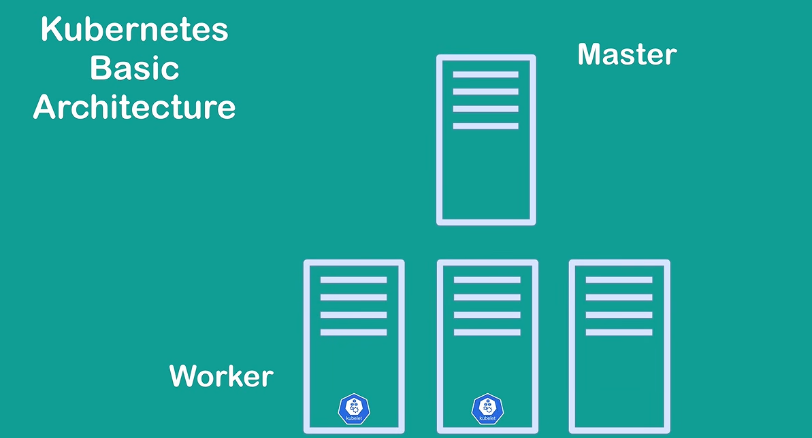
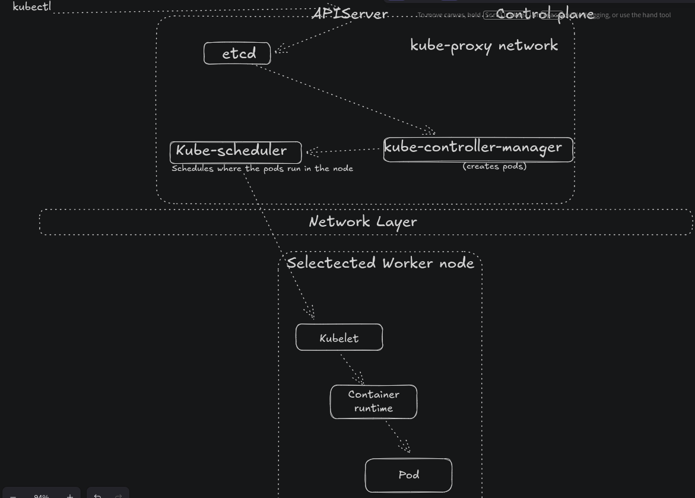

# Kubernetes: Basic Understanding

Hi, welcome to my Kubernetes repository.
In this documentation, I will be walking through my journey of understanding everything about Kubernetes. From the problem it is built to solve, a view into the architectural diagram and each component part that makes up the integral system of a highly available, self-healing system that makes orchestration of Workflows easier. 

This documentation is prepared to expose components, concepts, logics and the right implementation of Kubernetes. In the end a reader is not just aware of the capabilities of Kubernetes but also have deep knowledge of how the system operates under the hood. References to actual documentation links will also be shared along the way for reference and more deep dive into any part 

## What is Kubernetes?

Most people know Kubernetes as a workflow orchestration tool(data workflow)that’s a vague definition because by practical implementation there are tons of orchestration tools going by that definition alone. So what is an orchestration tool? 

Google defines an orchestration tool as software that automates, coordinates, and manages complex, multi-step workflows across multiple computer systems, applications, and services. This means in any case of  workflow such as the popular ones; like 
- Software Development (Continuous Integration / Continuous Deployment)
- Data Engineering & Analytics (Daily Financial Reporting)
- or even E-Commerce & Retail (Order-to-Delivery)
  
These are workflows that require sequence of operations to be managed at a specific time under certain conditions, should not fail at any point and must be successful in the end

Managing workflows like these requires coordination. This could actually be manually managed  (if there are few  parts involved).

At this point one might think "Docker" for managing data workflows. 

Yes, Docker is a data orchestration tool that manages containers. Where each container is a package of an application and its dependencies.

For example, imagine you have an ETL python application that is required to extract, transform and load data into a Postgres DB; both tools require dependencies such as libraries and credentials for this to work. If these dependencies change at any given time due to some differences then the Whole workflow fails.

To make this work the application and database are both containerized that is, packaged alongside their dependencies or credentials to be shipped anywhere. lol I guess the reason why docker has a shark logo.

But in docker, you would need to determine where they should run, manage failed containers, scale applications, and manage communication between them. This is a lot of Hats to wear for Docker or, worst case, an ordinary human. 

Also what happens when there are 100s or thousands of containers or tasks that need to be precisely coordinated? 

The workflow definitely requires a system that can eliminate manual coordination and must precisely give optimal results while dynamically considering the underlying infrastructures and the conditions that must be met for a successful workflow.

This is the kind of problem Kubernetes solves.

Kubernetes, according to the documentation, is a **portable**, **extensible**, open-source platform for managing **containerized** workloads and services that facilitate both **declarative configuration and automation**.

In addition to Docker's management of containers, Kubernetes has some extensible and flexible  features that help improve the life and health of this workflow. One of these featues is the concept of declarative state where you can give Kubernetes a set of instructions on how the state of your workflow should be, and it is automated as well

Kubernetes therefore is a portable and extensible platform that can run across different computing environments (machines) and can accommodate those additional capabilities.

* It helps us manage the complexities and unpleasant surprises that come with running hundreds of containerised applications across multiple servers.

* It ensures that these workloads are properly coordinated, supports communication between these workloads, responds to failures, and continuously works towards maintaining the desired state of our applications.

**In simpler terms, Kubernetes takes on much of the responsibility of managing and coordinating our containerised workloads, so we don't have to do everything manually.**

We can go on and on about how amazing Kubernetes is but if we do not get a mental picture of how Kubernetes works we may not fully grasp the full capabilities of this tool.

Therefore, let’s take a view of the architecture of Kubernetes

## Kubernetes Architectural View

On a high level, there are two major components of Kubernetes
- The Master (Control plane) and
- Worker

The combination of these components makes up the Kubernetes Cluster

The Control plane initially called Master is the brain of Kubernetes. It is the one responsible for Planning how to successfully run these workload while the Worker is responsible for executing the actual tasks involved. But these two do not work in isolation, nor are they just one component within.

The control plane, or Master  in itself has various components that make up what it is so does the worker 

We will go a step deeper into each of them to uncover how they function under the hood

> **Diagram showing worker and master nodes**

> 

## Control Plane

The control plane's components are the ones responsible for making  decisions about the cluster as well as detecting and responding to cluster events ( Expected or unexpected )

### Components of the Control Plane

### etcd

This can be referred to  as the memory of the control plane
It stores information about the Kubernetes cluster  including every resource Kubernetes needs to function, such as Pods, Deployments, Services, Nodes, ConfigMaps, and their desired and reported current states. (Don’t worry about these; we'll explore them in detail later on.)  

Now, if you understand what this means, you'll realise how important etcd is to Kubernetes. Let’s look at a quick example. Imagine you want Kubernetes to replicate your ETL container in 3 different places, etcd holds this information in its metastore so that the part responsible to achieve this reads this information and carries out the task. The act of writing your desired state is called **declaration of state** and etcd is responsible for holding that information

### kube-apiserver
If you’re familiar with api servers this should be easy one to recognise. Fundamentally, an API server acts as a middleman on an errand. Rather than you making a request directly to an application, the api helps take that request and returns the result. This is important for security and safety, especially for our etcd, that holds very special and important information. 

the Kube-apiserver is responsible for exposing the Kubernetes API. It is the first entry point of the control plane. Every request coming to the control plane hit’s the kube-apiserver first (documentation)

### kube-scheduler

Before we talk about kube-scheduler it’s worthy  to mention Pods here. It simply represents a set of running containers in the cluster.  
Therefore the kube scheduler is the one responsible for watching newly created pods and assigning them to worker nodes. There are so many factors that affect this scheduling, including available resources. like RAM, CPU, etc

### kube-controller-manager

Just as we briefly explained pods in the previous session, let us also do justice to controllers as well. 

A controller is a control loop that watches the shared state of the cluster( worker and master). It watches this process through the API server and makes changes from the current state to the desired state. 

Simply put, the controller keeps the whole cluster under surveillance, looking out for when the actual state of this cluster is changing from the desired state. In fact, the controller is our Military Guard commander lol

So what then is the work of kube-controller-manager?
It simply manages the controller. Because each controller runs as a separate process, the manager controls them as though they are a single unit of process. 

### cloud-controller-manager
With the mention of cloud, we can tell it’s the cloud manager for Kubernetes.  

It embeds cloud-specific control logic into the process, allowing you link your cluster into your choice cloud provider's API, and helps separate the components that interact with that cloud platform from components that only interact with your cluster.

## Worker or Node Components

These  components are seen in every node (Worker); they help in  maintaining running or active pods and provide the Kubernetes runtime environment.

Again, we're doing a deep dive into each component, starting with the kubelet

### Kubelet

I practically love this one; it sounds cute like a baby kube lol

Cute as it may sound, it is a powerful component of the node (worker machine). It is an agent that runs on each node in the cluster. 

It makes sure that containers are running in a Pod.

Remember, we said Pods represents a set of running containers, which means ideally containers run inside a Pod. The kubelet is responsible for making sure this process runs smoothly.

It does this through an operation that takes a set of resources (PodSpecs) that are provided through different mechanisms and ensures that the containers described in those resources (PodSpecs) are running and healthy. The kubelet does not manage containers that were not created by Kubernetes. It is Kubernetes-native container-aware

### kube-proxy
It's just, but not insignificant,  a network proxy that runs on each node in your cluster. It maintains network rules on nodes. These rules allow network communication to the Pods from inside or outside of the cluster.

### Container Runtime
Another of my favourite 

P.S 
I choose my favourites just based on how cute they sound. Please don’t take it personal lol

Container Runtime is a fundamental component that empowers Kubernetes to run containers effectively. This is not kubelet neither is it pod. It is simply responsible for managing the execution and lifecycle of containers within the Kubernetes environment.

> **Diagram showing path from kubectl to Pod in a node**
>
> 

## Some Add-ons Worthy of Mention Here

### Declarative Desired State

You’ll come across this term a lot in Kubernetes. And it’s only proper to have a good mental model for it.

When we talked about the controller in kube-controller-manager, we said the controller is the watchman that strictly monitors the actual state of the cluster, making sure it matches the desired state.  Kubernetes doesn't just know what the desired state is off the bat. It has to be declared, written, or specified somewhere. The state of a Kubernetes cluster is always declared.

### Namespaces
In Kubernetes, namespaces provide a mechanism for isolating groups of resources within a single cluster
. There are so many resources needed for Kubernetes to function, and each resource within a cluster needs to be uniquely and easily identified. Resources within a namespace are uniquely identified 

### Labels and Selectors
They’re key-value pairs that are attached to objects like Pods. They contain attributes of that object

## Some Commonly Asked Questions

### Why is a Pod not the same thing as a container?

Well, from our definition of pods and containers, although they work closely together,  
A Pod is a Kubernetes object and the smallest deployable unit in Kubernetes, while a container is the environment where the packaged application runs. example an ETL container

The Pod provides a shared execution logic for its containers, like networking and access to configured storage volumes.

### Which component decides where a Pod runs?
The part of the cluster that determines where a Pod runs will definitely be a control plane component, and that is the kube-scheduler. 

Remember, Pods are the smallest deployable unit that runs a container; therefore a Pod needs to be scheduled where it should run and  on what node. 

### What does declarative desired state mean?
Declarative desired state simply means telling Kubernetes what you want the state of your application to look like.

For example, you can declare that you want three replicas of your ETL application running. This state is written down in etcd where the resource responsible for observing this state- our watchman, **the controller**- monitors the etcd through the API Server, compares their actual state with the desired state, and takes the necessary actions to bring them into alignment.

In conclusion, Kubernetes is more than just a container orchestration tool; it is a system of interconnected components working together to ensure our containerized applications are properly deployed, managed, and maintained in their desired state.
